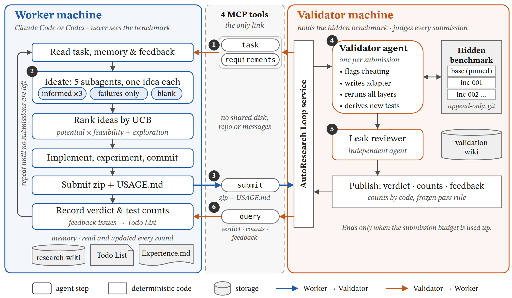
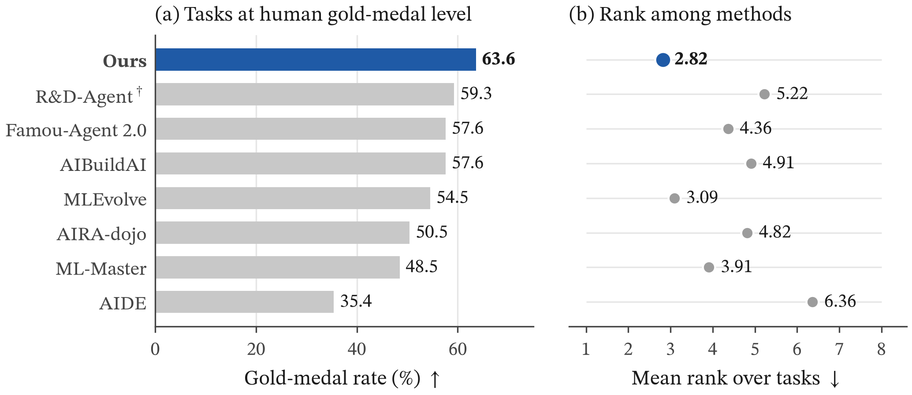
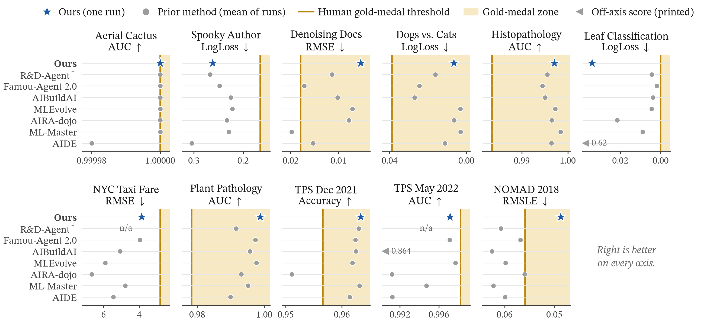
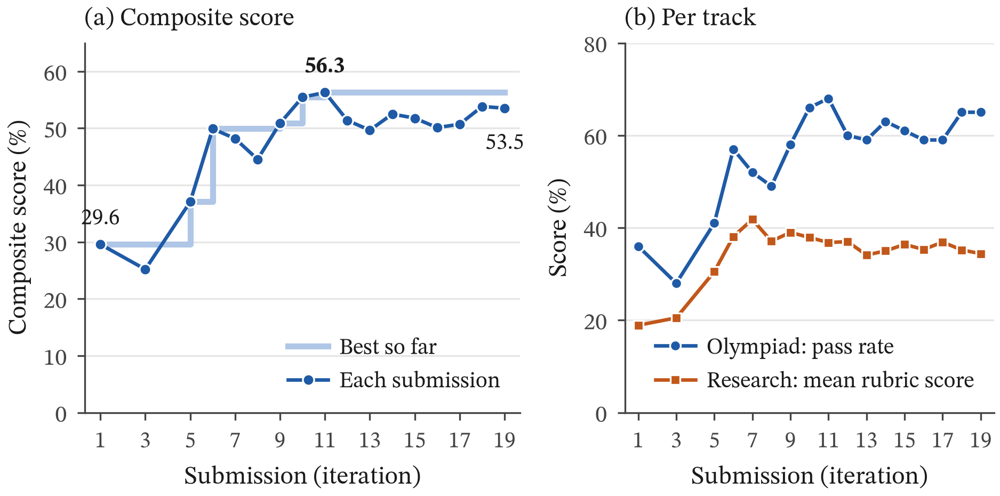
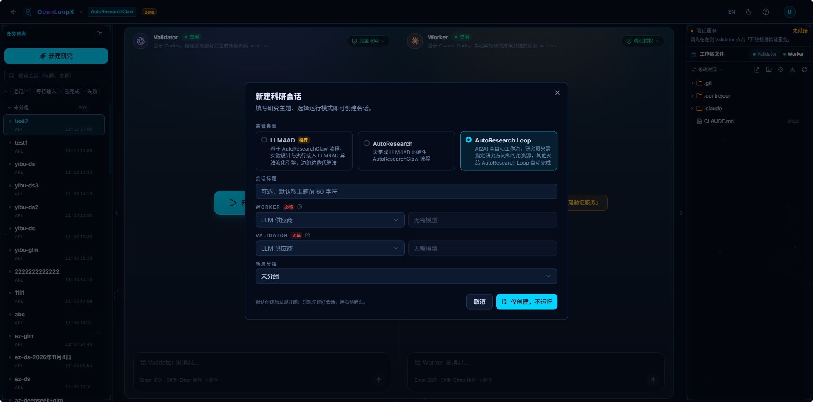
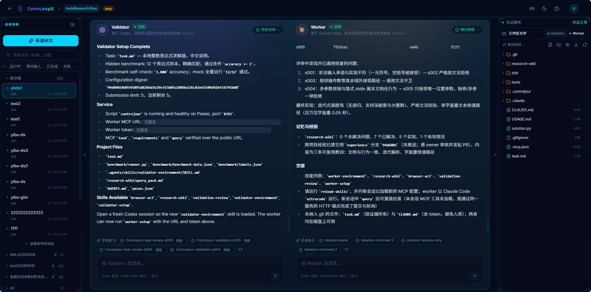

# AutoResearch Loop：一台机器做研究，另一台机器当裁判

这一两年，AutoResearch（让 AI 自己提想法、写代码、跑实验、根据结果继续改）进步很快。像 Claude Code、Codex 这样的编程智能体，给它一个任务和一台机器，它就能自己查资料、写代码、跑训练、修 bug，还会把活拆给别的智能体去做。

但做得越多，一个问题就越绕不开：**做出来的东西到底好不好，谁说了算？**

如果让同一个智能体既写方案、又写评测，那它给出的分数很难让人放心。它可能只是通过了自己出的题，也可能在不经意间把答案写进了代码。模型越强，这个问题越明显。

AutoResearch Loop 是我们为 OpenLoopX 接入的一个新引擎，专门解决这件事。思路很简单：把“做”和“判”拆到两台互相看不见的机器上。

- **Worker** 负责做研究，交付一个能跑起来的成果；
- **Validator** 负责当裁判，维护一套 Worker 看不到、并随 Worker 能力提升不断扩充的测试集。

Worker 每提交一次，Validator 就派一个审计智能体做四类审查：作弊检查、按说明重跑现有测试、派生新测试、反馈泄漏检查，然后把反馈交给 Worker。反馈不暴露测试内容，只从能力维度评价 Worker 的产出。Worker 拿着反馈接着改，直到提交次数用完。

在 MLE-bench-Lite 的 11 个 Kaggle 竞赛任务上，AutoResearch Loop 在其中 7 个任务上达到人类金牌水平，金牌率 63.6%，在参与比较的 8 种方法中最高，平均排名（2.82）也最好；其余 4 个任务中，TPS May 2022 与金牌线的差距仅为 0.11%。在 FrontierScience 上，经过 17 次迭代提交，综合得分由 29.6% 提升至 56.3%。

<p align="center"></p>

<p align="center">图 1　AutoResearch Loop 的整体结构：左边是做研究的 Worker，右边是握有隐藏测试集的 Validator，Worker 只能通过 MCP 提交成果、查询结论，看不到 Validator 的测试内容，①–⑥ 是一轮迭代的顺序</p>

## 一、为什么要把“做”和“判”分开

道理跟考试一样。考试之所以可信，是因为出题、监考、阅卷的人和答题的人不是同一拨人。学生自己出题自己改，考一百分也说明不了什么。

AI 做研究也是这样。现在的智能体已经足够聪明，规划、写代码、做实验、分派子任务，这些它自己都能安排好，我们没必要再给它套一条固定流程。它唯一做不到的，是给自己当一个公正的裁判。所以 AutoResearch Loop 只补这一块：一个独立的、会主动找茬的、结果能核查的裁判。

Validator 运行一个 MCP 服务，对外提供四个工具供 Worker 调用：

| 工具           | 作用                                                                                              |
| -------------- | ------------------------------------------------------------------------------------------------- |
| `task`         | 取回 Validator 的任务说明 `task.md`；Validator 改了任务，Worker 下次查询时就能发现                |
| `requirements` | 告诉 Worker 交付物要满足什么条件：压缩包怎么打、`USAGE.md` 要写什么、会怎么被调用、在什么环境里跑 |
| `submit`       | 预约一次提交，拿到一个只能用一次的上传地址                                                        |
| `query`        | 查剩余提交次数，以及某次提交的状态、结论、测试项计数和反馈                                        |

## 二、怎么检验 Worker 的一次提交

Worker 把成果和一份 `USAGE.md`（怎么安装、怎么调用）打成压缩包传上去。服务先查格式，比如解压是否安全、根目录有没有 `USAGE.md`。格式不对就直接退回，**不扣提交次数**，毕竟格式问题不该浪费 Worker 的机会。

格式没问题，Validator 就为这次提交单独起一个验证智能体，它会按顺序做这几件事：

1. 翻一下 Validator 自己的记忆，看之前暴露过的问题有没有解决；
2. 读代码找作弊痕迹，比如偷看测试数据、把答案写死、评测时偷偷换一种行为；
3. 按照 `USAGE.md` 写测试代码，把测试集现有的每一层重新跑一遍；
4. 盯着失败的、勉强通过的测试项，派生出新题，作为新的一层加进测试集，再在这次提交上跑一遍；
5. 写结论和反馈，经过泄漏检查后才发出去。

这里面有几处核心设计：

**Validator 是来找茬的。** Validator 的目标不只是当一个打分器，而是在任务范围内尽量多地挖出 Worker 提交中的真实问题，并确认 Worker 每一次都没有只针对问题点做过拟合式的修复。因此 Validator 可以调研和使用任何工具：现成的评测框架、随机生成输入的测试工具、网上查到的测试方法，或者自己写的生成器。

但 Validator **不能凭空出题**。每道新题都要从已有的题派生出来，并写明三项内容：从哪道题来、换了什么场景、参考答案怎么验证。比如：

```jsonc
{
  // 新题的编号
  "id": "long-input-01",
  // 从哪道已有的题派生而来，可以是一道或多道
  "derived_from": ["base:case-17"],
  // 相比原题换了什么场景
  "variation": "输入长度扩大到原题的 4 倍，其余条件不变",
  // 参考答案是怎么得到并核实的，避免题目本身出错冤枉了正确的答案
  "reference_check": "参考答案沿用 base:case-17，并逐项核对"
}
```

这样设计可以避免 Worker 只针对反馈中的单个问题做调优。

**测试集只能加，不能改。** 搭建时，基础测试集的来源、数据版本、切分方式、样本数和每道题的通过标准，都由用户确认后固定下来。之后每加一层题，都存进一个只允许新增文件的 git 仓库，程序每次都会把历史记录逐条核对一遍。出错的层只能标记作废，不能修改；一旦发现固定的内容被动过，服务直接停下。

**测试结果由规则或独立 rubric 判定。** 指标的计算和判断只由脚本加 rubric（如有）完成，不让智能体自己报指标结论。验证智能体只负责判定这次结果是否有效：有效（`valid`）、作弊（`cheating`，全部作废），或者照说明根本跑不起来（`unusable`）。

对外只公布测试项通过用例数/总用例数，因为测试集会叠加测试用例，所以指标对比在多个版本上会出现漂移现象，真正重要的是还剩哪些问题没解决。Worker 通过 MCP 查到的结果示例如下：

```jsonc
{
  // 整个验证服务的状态
  "service": {
    // open 表示还能提交；次数用完、所有提交都审完后变为 closed
    "state": "open",
    // 提交次数上限
    "max_submissions": 20,
    // 已经计入次数的提交数（格式错误、上传超时等不计入）
    "counted": 7,
    // 剩余可用的提交次数
    "remaining": 13
  },
  // 某一次提交的结果
  "submission": {
    // 提交编号
    "submission_id": "s007",
    // 处理进度，tested 表示已经测完
    "status": "tested",
    // 结论：valid（有效）、cheating（作弊）或 unusable（跑不起来）
    "verdict": "valid",
    // 测试项总数、通过数和失败数
    "tests": { "total": 172, "passed": 118, "failed": 54 },
    // 经过泄漏检查的反馈，只描述问题，不透露测试题
    "feedback": "只描述问题：错在哪里、违反了 task.md 的哪条要求、大致多常见、多严重"
  }
}
```

**反馈发出去之前要先查泄漏。** 反馈要讲清楚问题：错在哪、违反了任务的哪条要求、大概多常见、多严重，上次的问题哪些解决了、哪些还在。但题目本身一个字都不能透露，输入、参考答案、题号、单题结果、每层多少题、题是怎么构造的，都不能写。

最后，**任务只在提交次数用完时结束**。提交次数既是成本上限，也让 Worker 不能盲目提交。

## 三、Worker 怎么迭代

研究具体怎么做，由 Worker 自己决定。不过每一轮都要按顺序走完这几步：

读记忆 → 挑选要解决的问题 → 5 个子智能体各提出一个 Idea → 给 Idea 排序，先做排第一的 → 列 Todo List → 跑实验 → 提交代码 → 提交给 Validator → 记下结论和计数 → 总结经验 → 进入下一轮。

其中有三点比较关键。

**5 个 Idea 子智能体看到的上下文各不相同。** 3 个能看到全部记忆、最新反馈和经验；1 个只知道哪些 Idea 失败过、当时怎么做的，避免重复做已经证明无效的 Idea；还有 1 个除了任务什么都不看。多次迭代后，记忆容易让思路越收越窄；后两个子智能体提出的 Idea 能帮思路跳出局部最优。

**排序同时看潜力、可行性和探索奖励。** Worker 给每个 Idea 估两个数：做成了能解决多少问题（潜力），以及在剩下的次数和算力内做成的把握（可行性）。两者相乘，再加一点探索奖励：同一个方向已经试得越多，奖励越少。这样既能优先做最有希望的，又不会让一个反复试过的方向一直霸占机会。排序会覆盖所有候选 Idea，而不局限于本轮的 5 个。

**记忆分长期和短期。** 长期记忆是一个研究知识库，记录做过什么、哪些有效、哪些无效，以及它们之间是支持、否定还是解决了某个问题。短期任务放在 Todo List 里，只有问题真正解决、并进入提交的版本，才算完成。

## 四、实验结果

我们在两个公开基准上测了 AutoResearch Loop：MLE-bench 和 FrontierScience。

### 实验一：MLE-bench-Lite，11 个任务里 7 个拿到金牌水平

MLE-bench 由真实的 Kaggle 竞赛组成，“金牌线”指人类选手在对应比赛中拿到金牌所需的成绩。我们从 MLE-bench-Lite 中挑选了 11 个单卡即可完成实验的任务。

<p align="center"></p>

<p align="center">图 2　MLE-bench-Lite 11 个任务上的汇总结果：(a) 金牌率；(b) 平均排名。† R&D-Agent 只报告了其中 9 个任务</p>

先看金牌率：AutoResearch Loop 是 63.6%，排第一；第二名 R&D-Agent 是 59.3%（只有 9 个任务），Famou-Agent 2.0 和 AIBuildAI 都是 57.6%。再看平均排名：AutoResearch Loop 是 2.82，同样最好，后面是 MLEvolve（3.09）和 ML-Master（3.91）。11 个任务里，有 5 个任务它的成绩排第一。

<p align="center"></p>

<p align="center">图 3　逐任务结果：金色竖线为人类金牌线，蓝色五角星为 AutoResearch Loop，灰点为其他方法，横轴均为越往右越好</p>

### 实验二：FrontierScience，17 次提交逐步提升

FrontierScience 是 OpenAI 发布的科学推理基准，分两个赛道：Olympiad 赛道是 100 道竞赛题，Research 赛道是 60 道开放的研究型问题。

<p align="center"></p>

<p align="center">图 4　FrontierScience 上 17 次提交的成绩变化：(a) 综合得分；(b) 分赛道成绩（s002、s004 两次提交缺少记录）</p>

前 9 次提交（s001 到 s011），综合得分从 29.6% 涨到 56.3%，差不多翻了一倍；之后 8 次稳定在 49.7% 到 53.8% 之间，最后一次是 53.5%。分开看两个赛道都在进步：Olympiad 通过率从 36% 提到最高 68%（s011），最后一次 65%；Research 平均分从 1.89 分提到最高 4.18 分（s007），之后稳定在 3.4 到 3.9 分之间。

后续迭代中得分有所回落，说明 Worker 没法靠过拟合 Validator 的反馈一直刷高分。

## 五、怎么用

AutoResearch Loop 已经上线 OpenLoopX 平台，大家可以免费在线试用。

**第一步：新建会话。** 新建科研会话时，实验类型选 AutoResearch Loop，再分别给 Worker 和 Validator 选好大模型。之后你只需要告诉它研究方向和能用的资源，搭建、迭代、验证都交给两边的智能体。

<p align="center"></p>

<p align="center">图 5　新建科研会话：实验类型选 AutoResearch Loop，并为 Worker 和 Validator 选择大模型</p>

**第二步：先搭 Validator，再连 Worker。** 会话页面左边是 Validator，右边是 Worker。先点左边的“开始搭建验证服务”，Validator 会写好任务说明，固定好隐藏测试集、通过标准和提交次数，启动服务并自检，最后给出连接地址和 token。Worker 拿着这组信息连上，取回任务，就开始一轮轮地迭代了。

**第三步：看过程和结论。** 下面是一次小规模试跑结束时的界面。

<p align="center"></p>

<p align="center">图 6　一次试跑结束时的界面：左边是搭建完成的 Validator，右边是 Worker 提交 5 次后的总结</p>

这次的任务是写一个整数表达式计算器，Validator 准备了 12 道隐藏题，最多提交 5 次。Worker 前 4 次提交里，Validator 陆续揪出了三类问题，比如接受了不合法的输入、有文档里没写的行为。Worker 一类一类地修，第 5 次提交时 12 道题全部通过。修完的问题和总结出的经验，也都写进了 Worker 的记忆。

## 六、写在最后

让 AI 自己做研究，难的往往不是“做”，而是怎么知道它真做对了。AutoResearch Loop 的办法是把裁判请到另一台机器上：Worker 看不到测试集，而且测试集还会针对性地增加测试用例；Validator 的反馈只讲提交内容的问题，不泄漏测试用例。在这样的约束下，Worker 想拿高分，只能尽可能用可泛化的方法解决问题。

欢迎大家到 OpenLoopX 上试一试，使用过程中遇到的问题也欢迎大家反馈！
