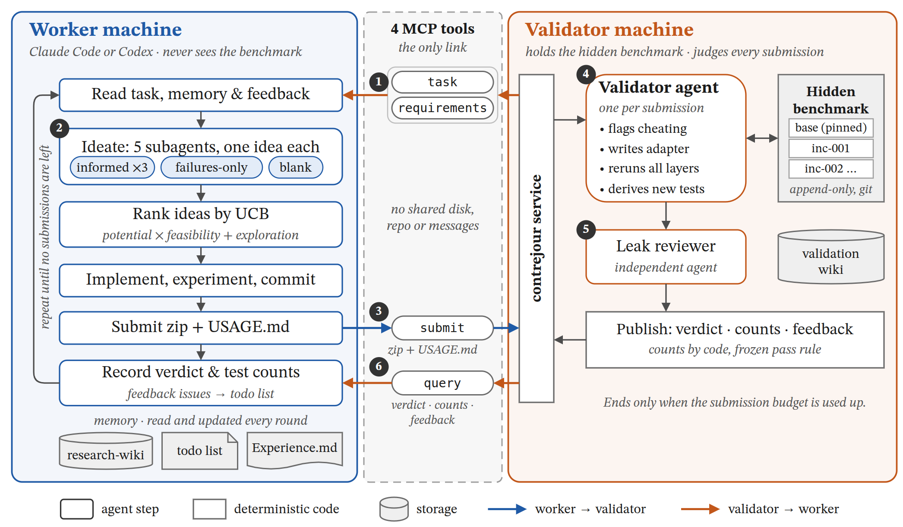
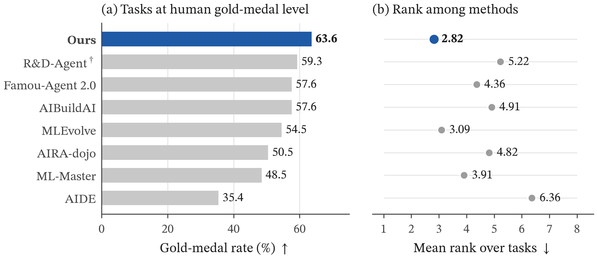
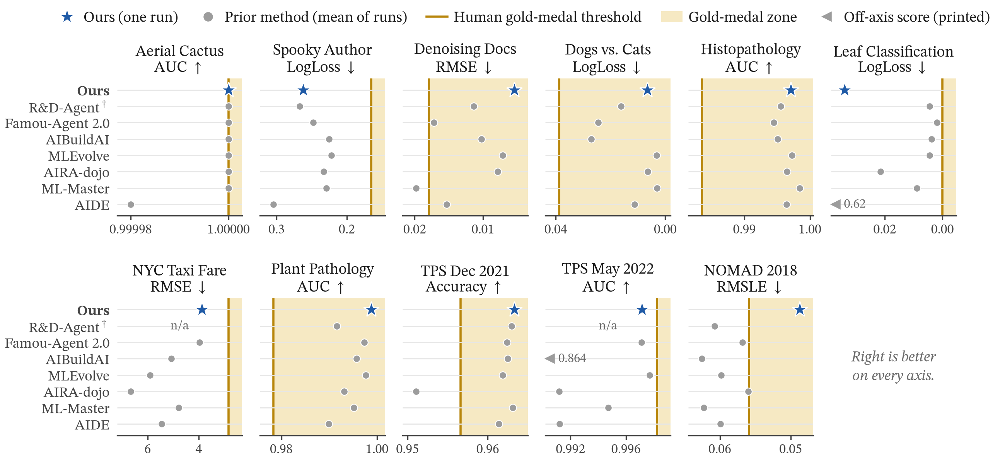
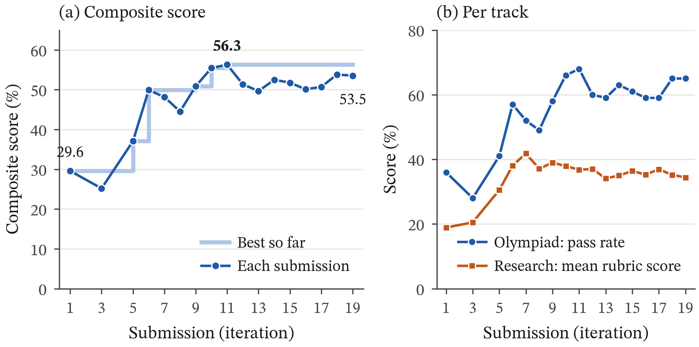
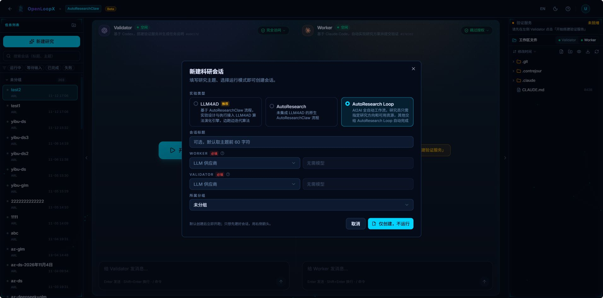
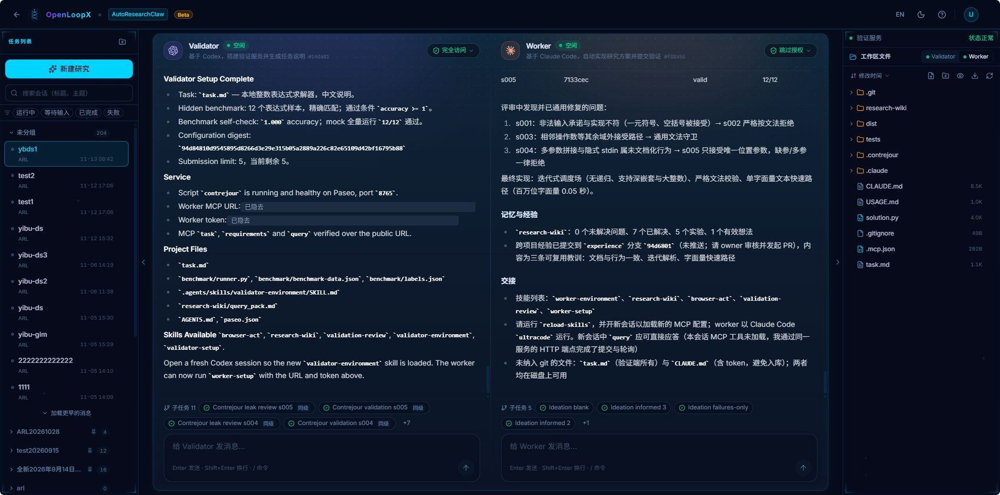

# Contrejour 开源：把“做”和“判”拆到两台机器上，让 AI 研究在对抗中迭代

现在的编程智能体（agent，例如 Claude Code、Codex 这类能自己操作电脑的 AI），拿到一个任务和一台机器，已经可以自己查资料、写代码、跑训练、修 bug，还能把子任务分给别的智能体。但有一件事它们仍然做不好：**给自己的成果下结论**。同一个智能体既写方案又写评测，评出来的分数很难让人放心。它可能只是通过了自己出的题，甚至在无意中把答案写进了代码。

**Contrejour** 只解决这一件事。它把一个研究任务拆给两台互相看不见的机器：**worker（做题方）** 负责“做”，交付一个能运行的成果；**validator（验证方）** 负责“判”，手里握着 worker 看不到、只增不改的测试集。每收到一次提交，验证方就启动一个专门找问题的验证智能体，最后公布三样东西：结论、通过了多少测试项，以及一份只讲问题、不泄露测试题的反馈。worker 根据反馈继续改进，直到提交次数用完。

在 MLE-bench 的 11 个 Kaggle 竞赛任务上，Contrejour 每个任务只运行一次，就有 **7 个任务达到人类金牌线（63.6%）**，在参与比较的 8 种方法中最高，平均名次也最好；没达到的 4 个任务里，TPS May 2022 离金牌线只差 0.11%。在 FrontierScience 上的 17 次提交中，综合得分从第 1 次的 **29.6% 提高到最高 56.3%**。

<p align="center"></p>

图 1　Contrejour 的系统结构。worker 和验证方在两台互相隔离的机器上，只通过中间 4 个工具连接。①–⑥ 是一轮迭代的顺序：取回任务和交付要求 → 读记忆、5 个子智能体出主意、按 UCB 排序后实现 → 提交压缩包 → 验证智能体对抗审查并派生新测试项 → 泄漏审查通过后发布 → worker 取回结论、计数和反馈，进入下一轮。

## 一、为什么要把“做”和“判”分开

考试之所以可信，是因为出题、监考、阅卷的人和答题的人是分开的。如果学生自己出题、自己批改，分数再高也说明不了什么。AI 自动做研究也一样：模型越强，越需要一个它影响不了的裁判。

Contrejour 的前身 ARIS 曾经把一轮研究写成固定的流水线：想法 → 实现 → 测试 → 审计 → 评审 → 停止。模型变强以后，这些固定步骤反而成了上限：模型本来能做得更灵活，却被流程卡住了。所以 Contrejour 删掉了流水线，只保留一条判断标准：**智能体自己能做的事，就不再替它安排流程。** 规划、写代码、做实验、派子智能体，都交给 worker 自己；Contrejour 只提供它自己做不到的那部分，也就是一个独立、对抗、可以核查的裁判。

两台机器之间只有一条通道：验证方机器上运行的一个服务，对外提供四个工具。worker 通过 MCP 调用它们，MCP 可以简单理解为“智能体能直接调用的接口”。

| 工具 | 作用 |
| --- | --- |
| `task` | 取回验证方的任务说明 `task.md`，逐字节一致；验证方改了任务，worker 下次查询时就会发现并重新取回 |
| `requirements` | 事先说明交付物要满足的条件：压缩包怎么打、`USAGE.md` 要写清什么、会被怎样调用、在什么环境里运行 |
| `submit` | 预约一次提交，拿到一个只能用一次的上传地址 |
| `query` | 查询剩余提交次数，以及某次提交的状态、结论、测试项计数和反馈 |

两边不共享磁盘、不共享代码仓库，也不互发消息。**防作弊不靠给 worker 定规矩，而是靠物理隔离：worker 根本读不到测试集。** 两台机器各自运行官方的 Paseo（一个用来启动和查看智能体的工具），每个角色都可以选择 Claude Code 或 Codex 来执行。

## 二、一次提交是怎么被检验的

worker 调用 `submit` 拿到上传地址，把成果和 `USAGE.md`（安装和调用说明）打成一个压缩包传上去。服务先检查格式：解压是否安全、根目录有没有 `USAGE.md`。格式不对直接退回，**不扣提交次数**，因为格式问题不该消耗 worker 的机会。格式通过后，服务为这次提交新建一个验证智能体，它依次做五件事：

1. 读验证方自己的记忆，看看之前的提交暴露过哪些问题还没解决；
2. 读代码找作弊迹象，比如偷看测试数据、把答案写死、在评测时换一种行为；
3. 照着 `USAGE.md` 自己写一段调用代码，把测试集现有的每一层都重新跑一遍；
4. 分析失败和勉强通过的测试项，围绕它们派生出新的测试项，登记成新的一层，再在这次提交上跑完；
5. 写出结论和反馈，交给另一个智能体做泄漏审查，通过后才发布。

这个过程背后有四条关键设计。

**第一，验证方和 worker 是对抗的。** 验证智能体的目标不是打一个分数，而是在 `task.md` 的范围内尽可能多地找出真实问题，并确认 worker 声称修好的问题是真的修好了，而不是只针对暴露问题的那几道题打了补丁。为此它可以使用任何工具：现成的评测框架、对输入做扰动或随机生成输入的测试工具、从网上查到的测试方法，或者自己写的生成器和检查器。

但它**不能凭空出题**。每个新测试项都必须从测试集里已有的测试项派生出来，并写明三件事：从哪道题来（`derived_from`）、改变了什么场景（`variation`）、参考答案怎么核实（`reference_check`）。例如（字段是真实字段，内容为示意）：

```json
{
  "id": "long-input-01",
  "derived_from": ["base:case-17"],
  "variation": "输入长度扩大到原题的 4 倍，其余条件不变",
  "reference_check": "参考答案沿用 base:case-17，并逐项核对"
}
```

这样做的道理是：新题是老题在相似场景下的变体。worker 如果真正修好了这一类问题，就不会被新题冤枉；如果只是记住了老题的答案，到新题上就会露馅。

**第二，测试集只增不改。** 搭建时，由用户确认基础测试集的来源、数据版本、切分方式、样本数量和每道题的通过标准，这些都会被固定下来。之后新增的每一层，都存放在一个只能由程序提交、每次提交只能新增文件的 git 仓库里，程序每次检查都会逐个核对历史提交。错了的层只能标记作废，不能修改；任何固定的文件或历史记录被改动，服务就会停止。所以“测试集被悄悄改过”这件事，在机制上就不可能发生。

**第三，测试结果不由智能体来报。** 测试集里每个样本就是一个测试项。它是否通过，由程序按照搭建时固定的规则（某个指标与阈值比较），从逐个样本的运行输出里算出来；交付物答错或者崩溃的测试项都算失败。验证智能体的结论只决定这次结果算不算数：`valid`（有效）、`cheating`（作弊，所有测试结果作废）或 `unusable`（照说明跑不起来）。对外只公布测试项的总数、通过数和失败数，不公布分数，也不比较不同的提交。原因是测试集一直在变大，数字本身的意义有限，重要的是还剩哪些问题。

worker 用 `query` 看到的结果大致是这样（字段是真实字段，数值为示意）：

```json
{
  "service": { "state": "open", "max_submissions": 20, "counted": 7, "remaining": 13 },
  "submission": {
    "submission_id": "s007",
    "status": "tested",
    "verdict": "valid",
    "tests": { "total": 172, "passed": 118, "failed": 54 },
    "feedback": "只描述问题：错在哪里、违反了 task.md 的哪条要求、大致多常见、多严重"
  }
}
```

**第四，反馈先过泄漏审查。** 反馈必须写清实际问题：交付物错在哪里、违反了 `task.md` 的哪项要求、大致多常见、多严重，以及上次的问题哪些解决了、哪些还在。但它不能透露测试题本身：输入、参考答案、题目编号、单题结果、每层题量和构造方式都不能写。这种判断没法写成脚本，所以由另一个**没有参与写反馈**的智能体，拿着反馈和全部隐藏测试逐条比对。判为泄漏就退回重写；重写次数用完仍然泄漏，就只发布结论和计数，不发反馈。**宁可少给信息，也不能把测试集漏给 worker。**

最后是停止条件：**唯一的停止条件是提交次数用完。** 通过全部现有测试项不会结束任务，因为验证方还会继续加题；上传超时、格式错误和验证方自己的故障都不计入次数。

## 三、worker 怎么迭代：带记忆的固定步骤

worker 具体怎么做研究由它自己决定，但每一轮都要按编号顺序走完这些步骤：

读记忆 → 选要解决的问题 → 5 个子智能体各提一个想法 → 给想法打分排序，先做排第一的 → 在待办清单里规划 → 跑实验 → git commit → 提交 → 记录结论和测试项计数 → 保存经验 → 回到第一步。

其中有三处设计值得展开。

**想法来自 5 个“知道得不一样多”的子智能体。** 3 个能看到全部记忆、最新反馈和经验；1 个只知道哪些想法失败过、当时是怎么做的，用来避开老路，又不被其余内容牵着走；1 个除了任务本身什么都不看。之所以这样安排，是因为迭代多轮以后，记忆会把方向越收越窄，后两个名额保证每一轮都有跳出已有思路的候选。

**按“潜力 × 可行性 + 探索奖励”给想法排序。** worker 给每个想法估两个 0 到 1 之间的数：潜力（如果做成了，能解决多少问题）和可行性（在剩下的提交次数和算力下做成的把握）。两者相乘，再加一个探索奖励：同一方向已经实测过的想法越多，奖励越小。这就是常说的 UCB 排序思路，既优先做看起来最有希望的，也不让一个反复试过的方向一直占着机会。没被选中的想法留在候选池里，下一轮和新想法一起重新排序。

**记忆分长短两层。** 长期记忆是一个研究知识库（research-wiki），用“问题、已有工作调研、想法、实验、论断”几类条目，加上“支持”“否定”“解决”“仍然复现”等证据关系，记录做过什么、哪些有效、哪些无效。每轮开始先读一份不超过 1000 个字符的摘要：每个未解决的问题占一行，标出有效（✔）和无效（✘）的尝试。短期任务放进待办清单，反馈里的每个问题都会变成一条待办，只有修进了已提交的交付物才能勾掉。

此外，搭建时会在真实机器上生成一份“环境说明”技能：只记录智能体无从得知的事实（主机、路径、资源、指标输出在哪、踩过的坑），以及验证过的固定脚本（同步代码、启动实验、查看状态、取回结果、停止）。每个实验单独命名，可以同时跑多个。跨项目的经验写进 Contrejour 源码仓库的 `Experience.md`：先提交到 `experience` 分支，经人审核合并之后，其他项目才会使用。

## 四、实验结果

我们在两个公开基准上测试了 Contrejour：MLE-bench（机器学习竞赛）和 FrontierScience（博士水平的科学问题）。

### 实验一：MLE-bench，11 个任务中 7 个达到人类金牌线

MLE-bench 把真实的 Kaggle 竞赛搬了进来，按当年的排行榜划定奖牌线。“金牌线”就是人类选手在这场竞赛里拿到金牌所需的成绩。我们选了 11 个任务，指标各不相同：有越大越好的（AUC、准确率），也有越小越好的（LogLoss、RMSE、RMSLE）。对比方法有 7 种：AIDE、R&D-Agent、AIRA-dojo、ML-Master、MLEvolve、Famou-Agent 2.0 和 AIBuildAI。

<p align="center"></p>

图 2　MLE-bench 11 个任务的汇总。(a) 达到人类金牌线的比例：已有方法先算每个任务多次运行中拿到金牌的比例，再对任务取平均；Ours 每个任务运行一次，即 11 个任务中达到金牌线的比例（7/11）。(b) 在每个任务上按成绩给各方法排名（1 为最好，并列时取平均名次），再对任务取平均。† R&D-Agent 只报告了其中 9 个任务，它的两项结果都按这 9 个任务计算；它缺席的 2 个任务只在其余 7 种方法中排名。

从图 2 可以看出两点。第一，Contrejour 达到金牌线的比例是 63.6%，高于第二名 R&D-Agent 的 59.3%（只按它报告的 9 个任务计算），以及 Famou-Agent 2.0 和 AIBuildAI 的 57.6%。第二，Contrejour 的平均名次是 2.82，好于 MLEvolve（3.09）和 ML-Master（3.91）；11 个任务中，有 5 个任务它的成绩排第一。

<p align="center"></p>

图 3　逐任务结果。每个小图是一个任务：金色竖线是人类金牌线，浅金色区域表示达到或超过金牌线；蓝色五角星是 Contrejour（单次运行），灰点是已有方法（多次运行的平均值）。所有横轴都统一成“越往右越好”；超出坐标范围的值画在边缘并标出数值，n/a 表示该方法没有报告这个任务。

### 实验二：FrontierScience，17 次提交中持续进步

FrontierScience 是 OpenAI 发布的科学推理基准，分两个赛道：Olympiad 赛道有 100 道竞赛题，答案正确就算通过；Research 赛道有 60 道开放的研究型子问题，每题按 10 分制评分。我们把两个赛道合成一个综合得分：

> 综合得分 =（Olympiad 通过题数 + 60 × Research 平均分 ÷ 10）÷ 160

可以把它理解为 160 道题的平均分：Olympiad 每题答对记 1 分，Research 每题把 10 分制的得分折算成 0 到 1 分。

<p align="center"></p>

图 4　FrontierScience 上 17 次提交的成绩（数据中没有 s002、s004 两次提交的记录）。(a) 综合得分：深蓝折线是每次提交的实际成绩，浅蓝阶梯线是截至当时的最好成绩。(b) 分赛道成绩：Olympiad 赛道的通过率，以及 Research 赛道的平均分（满分 10 分，折算成百分比）。

前 9 次提交（s001 到 s011）中，综合得分从 29.6% 升到 56.3%，最好成绩是起点的 1.9 倍；之后 8 次提交稳定在 49.7% 到 53.8% 之间，最后一次为 53.5%。拆开看，两个赛道都在进步：Olympiad 通过率从 36% 提高到最高 68%（s011），最后一次为 65%；Research 平均分从 1.89 分提高到最高 4.18 分（s007），之后回落并稳定在 3.4 到 3.9 分之间。

曲线并不是一路向上的：s003 一度跌到 25.2%，s008 也回落到 44.5%。这两次回落，都在随后一两次提交中被追回，并超过了回落前的成绩。

## 五、怎么用

在 OpenLoopX 平台中，Contrejour 对应的实验类型是 **AutoResearch Loop**。

**第一步：新建会话，选择 AutoResearch Loop。** 新建科研会话时，实验类型选 AutoResearch Loop，再分别为 Worker 和 Validator 选好 LLM 供应商。按页面上的说明，研究员只需要指定研究方向和可用资源，之后的搭建、迭代和验证都由两侧的智能体完成。

<p align="center"></p>

图 5　新建科研会话：实验类型选 AutoResearch Loop，Worker 和 Validator 都必须选择 LLM 供应商；默认创建后立即开始运行。

**第二步：先搭验证端，再连接 worker。** 会话页面左边是 Validator，右边是 Worker（图 6 中分别基于 Codex 和 Claude Code）。先在左侧点击“开始搭建验证服务”：验证端会写好任务说明，固定隐藏测试集、通过标准和提交次数，启动验证服务并自检，最后给出 worker 的连接地址和 token。worker 用这组连接信息完成初始化、取回任务说明，然后按第三节的步骤开始迭代。

**第三步：看迭代过程和验证结论。** 图 6 是一次小规模运行结束时的界面。

<p align="center"></p>

图 6　一次完整运行的结尾。左：验证端搭建完成，列出任务、隐藏测试集、提交上限、服务状态和 worker 的连接信息（地址和 token 已隐去）；右：worker 完成 5 次提交后的总结，包括验证中发现并修好的问题、最终实现，以及记忆与经验。

从图 6 可以看到前文的几处设计是怎么落地的：

- **验证端先就绪**：任务是写一个本地的整数表达式求解器；隐藏测试集有 12 个表达式，答案必须完全一致才算通过，搭建时自检 12/12；提交上限 5 次；验证服务在 Paseo 中运行正常，`task`、`requirements`、`query` 三个工具都已经通过公开地址验证。
- **问题被一类一类地找出来并修好**：worker 一共提交了 5 次，最后一次（s005）被判为有效，通过 12/12。右侧列出了审查中暴露、随后修好的三类问题：s001 会接受一元符号、空括号等不合法的输入，和说明里的承诺不符，s002 改为严格按文法拒绝；s003 还有相邻操作数等其他不该接受的输入能通过，于是加了一层通用的文法检查；s004 有没写进文档的行为（把多个参数拼在一起、悄悄从标准输入读取），s005 改为只接受唯一一个参数，缺了或多了都拒绝。三次修复针对的都是一类问题，而不是某一道题。最终版本用不递归的方式解析表达式，支持深层嵌套和大整数；输入只是一个数字时走快速路径，百万位的数字 0.05 秒就能处理完。
- **结果写进记忆**：研究知识库的最终状态是 0 个未解决问题、7 个已解决、5 个实验；三条跨项目经验（说明文档要和实际行为一致、用迭代方式解析表达式、单个数字走快速路径）提交到了 `experience` 分支，等 owner 审核后再合并。
- **每个角色都有对应的子任务**：验证端底部是每次提交的验证智能体（validation）和独立的泄漏审查（leak review）；worker 底部的 5 个子任务是出主意的子智能体，名字里的 blank、failures-only、informed 正是第三节说的三类名额。
